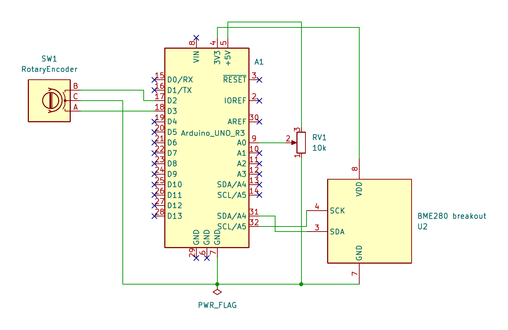
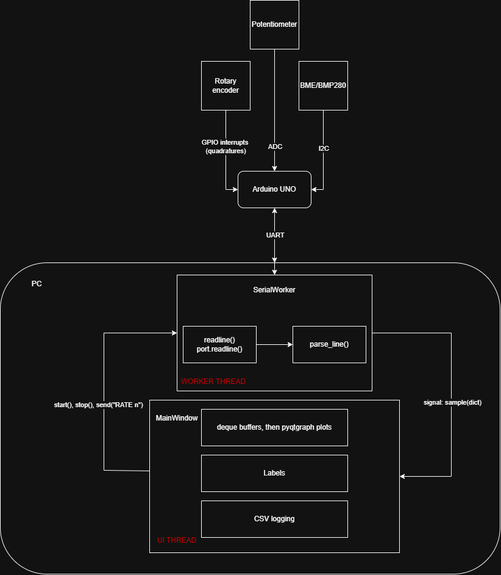

<h1>TelemetryDeck project</h1>
I want to get more familiar with data visualization, specifically with PyQt. Using my embedded experience with UART and I2C. This project is a telemetry deck reading sensor data and visualizing it through PyQt.

<h2>On hand equipment</h2>

 - Arduino UNO
 - Rotary encoder
 - Potentiometer
 - BME280 (I2C)

<h2>Goals</h2>

 - Get familiar with PyQt5, designer and QSS
 - Freshen up basic embedded skills I2C / UART
 - Freshen up embedded C knowledge
 - Practice understandeable git logs and documentation

<h2>Setup </h2>

<h2>Software stack</h2>
<h3> Firmware / Arduino (CPP) </h3>
Built with PlatformIO

| Part | Used for |
|---|---|
| Arduino framework (C++) | Main loop, timing, serial I/O |
| `Wire` | I2C communication with the sensor |
| Adafruit BME280 and BMP280 libraries | Temperature, pressure, humidity (BME280 only) |
| Adafruit Unified Sensor | Shared base library required by the Adafruit drivers |
| Encoder (PJRC) | Interrupt-based rotary encoder counting |
| `analogRead` | Potentiometer position (10-bit ADC) |
| `Serial` (UART, 115200 baud) | Telemetry out, commands in |

<h3> Dashboard (Python 3)</h3>

| Part | Used for |
|---|---|
| PyQt5 | GUI framework |
| Qt Designer and `uic` | Window layout in a `.ui` file, loaded at runtime |
| QSS | Dark theme stylesheet |
| pyqtgraph | Real-time plots |
| pyserial | Reading and writing the serial port |
| `QThread`, signals and slots | Serial I/O off the UI thread |
| `collections.deque`, `csv` | Rolling plot buffer, data logging |

<h3> Tools </h3>

 - Git
 - KiCAD
 - PlatformIO
 - Python venv

<h3>Data flow</h3>

The Arduino collects three kinds of input: the rotary encoder (quadrature signals read through GPIO interrupts), the potentiometer (analog voltage read by the ADC) and the BME/BMP280 (I2C). Every sample interval it sends one CSV line over UART to the PC.

On the PC, a `SerialWorker` thread reads each line with `port.readline()` and converts it with `parse_line()`. It hands the result to the UI through the `sample(dict)` signal, so the worker never touches a widget and the window stays responsive. The `MainWindow` stores the values in fixed-size deque buffers, draws them with pyqtgraph, updates the labels and logs them to CSV.

The control path runs the other way: the UI can start and stop the worker and send commands such as `RATE n` back to the Arduino over the same serial link.

 