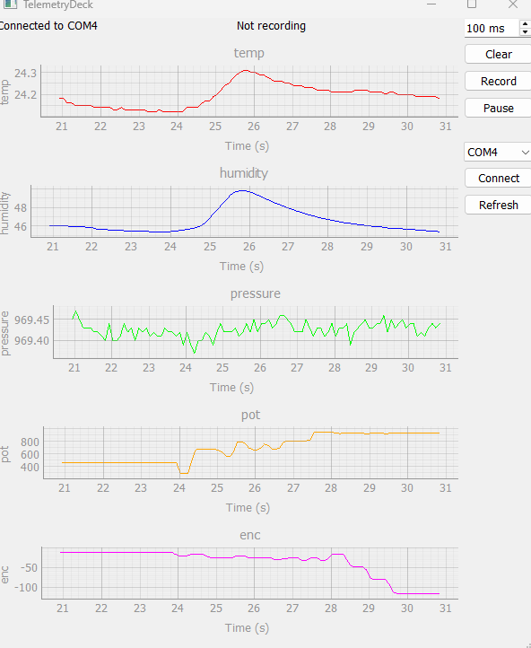

# TelemetryDeck

A small telemetry dashboard: an Arduino Uno streams sensor data over UART to a PyQt5 desktop app that plots it live, logs it to CSV and sends commands back to the board.

I built it to get more familiar with data visualization in PyQt, using my embedded experience with UART and I2C.



*The dashboard receiving live data from the Arduino. The control panel (right) selects the port, sets the sample interval, pauses the display, clears the plots and records to CSV.*

## Features

- One live plot per value (temperature, humidity, pressure, potentiometer, rotary encoder)
- Serial port selection with refresh, plus a **Fake** source for demos without hardware
- Change the board's sample interval at runtime (20 to 10000 ms)
- Pause the display while data keeps being collected
- Clear the plots
- Record to a timestamped CSV file (recording continues while the display is paused)

## Goals

- Get familiar with PyQt5, Qt Designer and QSS
- Freshen up basic embedded skills: I2C and UART
- Freshen up embedded C/C++ knowledge
- Practice understandable git history and documentation

## Hardware

| Part | Connection |
|---|---|
| Arduino Uno | USB to PC (UART at 115200 baud) |
| BME280 (I2C, address 0x76) | SDA/SCL (A4/A5) |
| Potentiometer | A0 |
| Rotary encoder | D2 and D3 (interrupt pins) |


## Software stack

### Firmware (C++, PlatformIO)

| Part | Used for |
|---|---|
| Arduino framework | Main loop, timing, serial I/O |
| `Wire` | I2C communication with the sensor |
| Adafruit BME280 | Temperature, pressure, humidity |
| Adafruit Unified Sensor | Shared base library required by the Adafruit drivers |
| Encoder (PJRC) | Interrupt-based rotary encoder counting |
| `analogRead` | Potentiometer position (10-bit ADC) |
| `Serial` (UART, 115200 baud) | Telemetry out, commands in |

### Dashboard (Python 3)

| Part | Used for |
|---|---|
| PyQt5 | GUI framework |
| Qt Designer and `uic` | Window layout in `dashboard.ui`, loaded at runtime |
| pyqtgraph | Real-time plots |
| pyserial | Reading and writing the serial port |
| `QThread`, signals and slots | Serial I/O off the UI thread |
| `collections.deque`, `csv` | Rolling plot buffers, data logging |
| pytest | Unit tests for the parser and the recorder |

### Tools

Git, KiCad, PlatformIO, Python venv

## Running the dashboard

**1. Flash the firmware.** Open `software/firmware` in PlatformIO and upload it to the Arduino. Close any serial monitor afterwards, since only one program can use the port at a time.

**2. Install and start the app** (Windows, from the repository root):

```
python -m venv .venv
.venv\Scripts\activate
cd software\dashboard
pip install -r requirements.txt
python main.py
```

**3. This is what you see when the app opens:**


**4. Connect.**
1. Choose the Arduino's COM port in the drop-down (press **Refresh** if it isn't listed). No board? Choose **Fake** to run on generated data.
2. Press **Connect**. The status label shows the port, and the five plots start scrolling.

**5. Use the controls.**

| Control | What it does |
|---|---|
| Interval box | Sets how often the board sends a sample (20 to 10000 ms). Press Enter or use the arrows to apply. |
| Pause / Resume | Freezes the plots. Data keeps being collected. |
| Clear | Empties the plots |
| Record / Stop | Writes every sample to `software/dashboard/logs/telemetry_<timestamp>.csv` |

Run the unit tests with `python -m pytest -v` in `software\dashboard`.

## Serial protocol

All messages are text lines ending in `\n`, at 115200 baud.

| Direction | Message | Meaning |
|---|---|---|
| Arduino to PC | `ms,temp,pressure,humidity,pot,enc` | One sample, e.g. `122,23.98,972.51,45.11,256,0` |
| Arduino to PC | `# ...` | Status or reply line, ignored by the data parser |
| PC to Arduino | `INTERVAL <ms>` | Set the sample interval (clamped to 20 to 10000 ms) |
| Arduino to PC | `# interval set to <ms>` | Confirmation |
| Arduino to PC | `# unknown command` | The line was not a valid command |

Units: `ms` is milliseconds since boot, `temp` in °C, `pressure` in hPa, `humidity` in %RH, `pot` is the raw ADC value (0 to 1023) and `enc` is the encoder count.

## Data flow

The Arduino collects three kinds of input: the rotary encoder (quadrature signals read through GPIO interrupts), the potentiometer (analog voltage read by the ADC) and the BME280 (I2C). Every sample interval it sends one CSV line over UART to the PC.

On the PC, a `SerialWorker` thread reads each line with `readline()` and converts it with `parse_line()`. Lines that are not valid data (status lines, partial lines, bad numbers) are dropped. The worker hands each result to the UI through the `data(dict)` signal, so it never touches a widget and the window stays responsive. `MainWindow` stores the values in fixed-size deque buffers, draws them with pyqtgraph and passes every sample to the `Recorder`, which writes it to the CSV file.

The control path runs the other way: the UI can start and stop the worker and send `INTERVAL <ms>` back to the Arduino over the same serial link. A `FakeWorker` with the same interface generates sine-wave data, so the UI can be developed and demonstrated without hardware.


## Project structure

```
hardware/                      Schematic (KiCad export)
software/
  firmware/                    PlatformIO project (Arduino, C++)
  dashboard/
    main.py                    MainWindow: plots, controls, wiring
    dashboard.ui               Layout, made in Qt Designer
    workers.py                 parse_line, SerialWorker, FakeWorker
    recorder.py                CSV recorder
    test_workers.py            Parser tests
    test_recorder.py           Recorder test
    requirements.txt
  diagrams/                    Images used in this README
```

## Known limitations and next steps

- No explicit Disconnect button yet (reconnecting replaces the worker)
- Dark QSS theme not implemented yet
- Plot window is a fixed number of samples rather than a fixed time span
- Connection errors are not yet shown in the UI